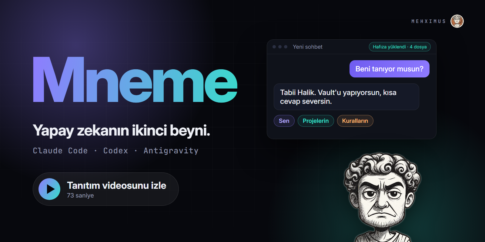

# 🧠 Mneme

[](https://github.com/haliksuveyt/mneme/actions/workflows/v3.yml)
[](https://github.com/haliksuveyt/mneme/releases/latest)
[](LICENSE)

[Türkçe](README.md) · **English**

[](https://youtu.be/weSUupkkIJ8)

**A local second brain for AI coding agents.** Your notes stay plain Markdown in a folder
you own (an Obsidian vault works as is). Claude Code, Codex, Google Antigravity, Hermes,
OpenCode and OMP all read and write the same memory, so what you teach one agent the
others know too.

- **No server, no account, no API key.** Python 3.11+ standard library only. The engine
  itself never calls a model.
- **Source-backed memory.** Every recalled fact names the Markdown file it came from, and
  work sessions end with a *receipt*: a short, source-linked record of what was done. Stale
  sources are excluded instead of being presented as fresh.
- **Fits the agent's context window.** Hooks inject a small, budgeted opening (identity,
  your corrections, the last session's handoff, open threads) and per-turn matches only
  when the prompt really matches something.
- **Turkish-first search, works in English.** BM25 ranking with a Turkish stemmer and
  diacritic folding; on the bundled 32-query benchmark Recall@1 is 93.8% (MRR 0.964).

## Install

Open your notes folder in Claude Code, Codex or Antigravity and paste:

> Read https://raw.githubusercontent.com/haliksuveyt/mneme/main/mneme.md. Install my second
> brain in this folder. If an installation exists, update it and keep my notes. Do the
> download and install steps yourself. At the end, save a sample fact and read it back in a
> new session so we can verify it together.

The agent finds the latest stable release, verifies its SHA-256, installs and runs the health
check. Manual install: download `mneme-v3-X.Y.Z.zip` from
[Releases](https://github.com/haliksuveyt/mneme/releases/latest), then

```sh
python3 scripts/install_v3.py --vault "/path/to/your/vault"   # Windows: py -3
```

Start a new session in the vault and approve the client's hook trust prompt.

## Everyday commands

Run inside the vault (`py -3` instead of `python3` on Windows):

| Command | What it does |
| --- | --- |
| `python3 mneme.py doctor` | Health check that names every cause behind a warning |
| `python3 mneme.py recap --since 2026-10-01` | Source-linked outcomes of a date range |
| `python3 mneme.py stats` | Notes, receipts, sessions and the most cited sources |
| `python3 mneme.py yakala kur` | Optional one-key capture (Ctrl+Alt+B) of a page, text or file into the inbox |
| `python3 mneme.py mcp` | MCP server for clients without hooks |
| `python3 mneme.py update` | Update from the official stable release, with rollback |

Or just talk to the agent: *"remember that…"*, *"what did we decide about…"*,
*"process what I captured"*, *"update my brain"*.

## How it works

```
Markdown vault (source of truth)
   │  sync: hash-checked, incremental
   ▼
local SQLite index (outside the vault)  ──►  hooks / MCP  ──►  agent context
   ▲                                                      │
   └──────── receipts, notes, tasks written by the agent ◄┘
```

Companion files (`Core.md`, `Kurallar.md` = your rules, `Last-Session.md`, `Threads.md`,
`Journal.md`) give the agent continuity. Rules and identity that do not fit a client's opening
limit arrive whole on the first turn instead of being cut.

## Docs

[Quickstart](docs/v3/QUICKSTART.md) · [Preferences](docs/v3/PREFERENCES.md) ·
[Markdown format](docs/v3/MARKDOWN.md) · [Updates](docs/v3/UPDATE.md) ·
[MCP](docs/v3/MCP.md) · [Multiple machines](docs/v3/MULTI-MACHINE.md) ·
[Release notes](docs/v3/releases/)

Most documentation is in Turkish; commands and file formats are the same in every language.

## License

[MIT](LICENSE) © 2026 Halik Suveyt.
