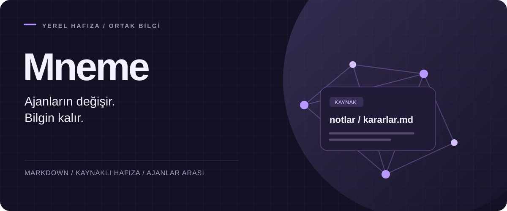
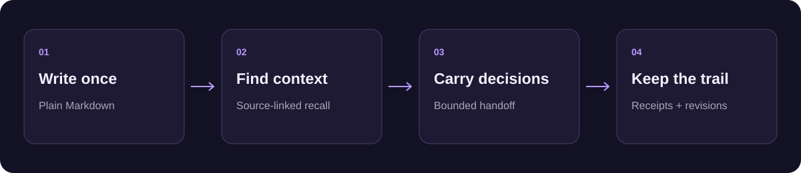

<p align="center"></p>

<p align="center"><strong>English</strong> · <a href="README.tr.md">Türkçe</a></p>

<p align="center"><a href="https://github.com/haliksuveyt/mneme/actions/workflows/v3.yml"></a> <a href="https://github.com/haliksuveyt/mneme/releases/latest"></a> <a href="LICENSE"></a></p>


# A second brain your agents can share

Keep project decisions, personal context and lessons in a folder you own. Mneme brings the right source-backed context into your next AI session, records what changed and carries your work between agents.

**Claude Code · Codex · Antigravity · Hermes · OpenCode · OMP**

| Your knowledge | Your workflow | Your next session |
|---|---|---|
| **Plain Markdown** you can read and edit anywhere | **Automatic context** from shared notes and rules | **Source-linked handoffs** with decisions and open work |

## One folder. One message.

Python **3.11+**. Open your notes folder in your AI coding client and send:

> Read https://raw.githubusercontent.com/haliksuveyt/mneme/main/mneme.md and install my second brain in this folder. Preserve my existing notes, verify the official release checksum, complete the setup and health check, then save an example fact and retrieve it in a new session.

Your agent installs the official portable package and connects the client to the shared memory. Complete your client's workspace and hook trust review, then open a new session.

### Prefer a manual install?

Download `mneme-v3-3.12.0.zip` and its `.sha256` from [the release page](https://github.com/haliksuveyt/mneme/releases/latest), verify the checksum and extract the ZIP. From the extracted folder:

```bash
# macOS / Linux
python3 scripts/install_v3.py --vault "/path/to/My Notes"
# Windows
py -3 scripts/install_v3.py --vault "C:\Notes\My Brain"
```

Existing users can run `python3 mneme.py update` from their vault; on Windows use `py -3 mneme.py update`.

## Remember the work, not just the chat



- **Context that follows the task.** Recall carries the source path, revision and relevant text, with a configurable context budget.
- **Decisions stay decisions.** Handoff packets separate accepted decisions, proposals, open tasks and other context using explicit metadata.
- **Changes stay visible.** Compare two handoff packets to see source, metadata and text changes.
- **Work has a trail.** Source-linked receipts, revision-aware task updates and session handoffs keep the record connected to the notes.
- **A folder you control.** The local memory engine uses Python's standard library. AI client access remains with your chosen client.

```bash
python3 mneme.py context "project decisions"
python3 mneme.py handoff "Orbit" --project orbit --to codex
python3 mneme.py handoff-diff --before before.json --after after.json
```

## Built around sources

Markdown is the source of truth. Sync updates the local index; recall respects source freshness, visibility and validity. Accepted decisions come from metadata. A receipt records a work outcome with references to the supporting sources.

[Handoff guide](docs/v3/HANDOFF.md) · [Source format](docs/v3/MARKDOWN.md) · [Preferences](docs/v3/PREFERENCES.md) · [Update and rollback](docs/v3/UPDATE.md)

## See it in action

[Watch the product walkthrough](https://youtu.be/weSUupkkIJ8) · [Engineering case study](docs/v3/CASE-STUDY.md) · [3.12.0 release notes](docs/v3/releases/3.12.0.md)

The handoff layer has **60 source-contract scenarios**, packet-diff tests and real Sol continuation evidence. CI exercises Linux, macOS and Windows with Python 3.11 and 3.13. The [case study](docs/v3/CASE-STUDY.md) explains the experiment and design decisions.

## Choose your client

[MCP](docs/v3/MCP.md) · [Hermes](docs/v3/HERMES.md) · [OpenCode](docs/v3/OPENCODE.md) · [OMP](docs/v3/OMP.md) · [Multiple machines](docs/v3/MULTI-MACHINE.md)

The [Turkish step-by-step setup](KURULUM.md) starts from creating your first notes folder. Existing Markdown and Obsidian folders work directly.

Built by [Halik Suveyt](https://github.com/haliksuveyt). [MIT license](LICENSE) · [Issues](https://github.com/haliksuveyt/mneme/issues)
