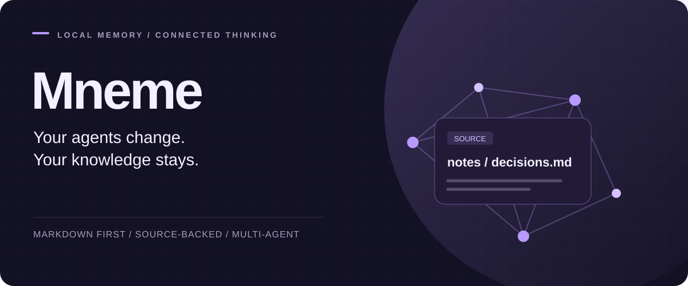

<p align="center"></p>

<p align="center"><strong>English</strong> · <a href="README.tr.md">Türkçe</a></p>

<p align="center"><a href="https://github.com/haliksuveyt/mneme/actions/workflows/v3.yml"></a> <a href="https://github.com/haliksuveyt/mneme/releases/latest"></a> <a href="LICENSE"></a></p>


# A second brain your agents can share

You keep project decisions, notes and lessons in a folder of plain Markdown. Mneme hands them to your AI agents together with their sources, so a new session or a different agent can see where the last one left off.

**Claude Code · Codex · Antigravity · Hermes · OpenCode · OMP**

## Install

Requires Python 3.11 or newer. Open your notes folder in your AI client and send:

> Read https://raw.githubusercontent.com/haliksuveyt/mneme/main/mneme.en.md and install my second brain in this folder. Preserve my existing notes, verify the official release checksum, complete the setup and health check, then save an example fact and retrieve it in a new session.

The agent installs the package and connects the client to the shared memory. If the client asks for trust, inspect the vault path and the hook definitions shown; approve them when they match the Mneme setup you expect. Then open a new session.

### Manual install

Download `mneme-v3-3.12.1.zip` and its `.sha256` from [the release page](https://github.com/haliksuveyt/mneme/releases/latest), verify the checksum and extract the ZIP. From the extracted folder:

```bash
# macOS / Linux
python3 scripts/install_v3.py --vault "/path/to/My Notes"
# Windows
py -3 scripts/install_v3.py --vault "C:\Notes\My Brain"
```

Existing users can run `python3 mneme.py update` from their vault; on Windows use `py -3 mneme.py update`.

## How it works


- Context is picked per task: the relevant text arrives with its source path and revision, within a configurable budget.
- Handoff packets keep accepted decisions, proposals and open tasks separate.
- You can compare two handoff packets to see source, metadata and text changes.
- Finished work leaves a record: source-linked receipts, revision-checked task updates and session cards.
- The memory engine runs locally on Python's standard library; AI access stays with the client you choose.

```bash
python3 mneme.py context "project decisions"
python3 mneme.py handoff "Orbit database migration" --project orbit --harness claude --to codex --audience internal
```

`--harness` selects the client creating the packet; `--to` labels its recipient and does not message another client. The packet is written to stdout. For a complete synthetic example that creates both packets and shows their diff, see the [handoff guide](docs/v3/HANDOFF.en.md).

## Sources

Markdown files are the source of truth. Sync updates the local index, and recall takes freshness, visibility and validity into account. Accepted decisions come from metadata. A receipt records the outcome of a piece of work with its supporting sources.

[Handoff guide](docs/v3/HANDOFF.en.md) · [Source format](docs/v3/MARKDOWN.md) · [Preferences](docs/v3/PREFERENCES.en.md) · [Update and rollback](docs/v3/UPDATE.en.md)

## More

[Watch the product walkthrough](https://youtu.be/weSUupkkIJ8) · [Engineering case study](docs/v3/CASE-STUDY.md) · [3.12.1 release notes](docs/v3/releases/3.12.1.md#english)

The handoff layer was tested with 60 source-contract scenarios, packet-diff tests and real agent handoff sessions. CI runs on Linux, macOS and Windows with Python 3.11 and 3.13. The method and design decisions are in the [case study](docs/v3/CASE-STUDY.md).

## Client guides

[MCP](docs/v3/MCP.en.md) · [Hermes](docs/v3/HERMES.md) · [OpenCode](docs/v3/OPENCODE.md) · [OMP](docs/v3/OMP.md) · [Multiple machines (Turkish)](docs/v3/MULTI-MACHINE.md)

The [Turkish installer guide](mneme.md) provides the full one-message installation instructions.

Built by [Halik Suveyt](https://github.com/haliksuveyt). [MIT license](LICENSE) · [Issues](https://github.com/haliksuveyt/mneme/issues)
