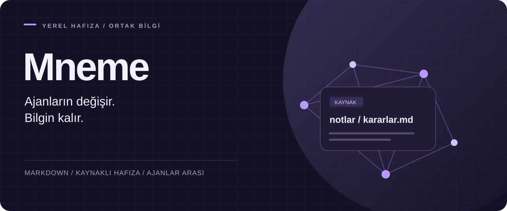
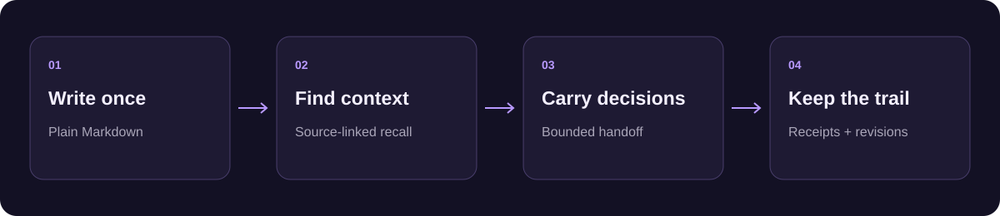

<p align="center"></p>

<p align="center"><strong>Türkçe</strong> · <a href="README.md">English</a></p>

<p align="center"><a href="https://github.com/haliksuveyt/mneme/actions/workflows/v3.yml"></a> <a href="https://github.com/haliksuveyt/mneme/releases/latest"></a> <a href="LICENSE"></a></p>


# Ajanlarının ortak ikinci beyni

Proje kararlarını, notlarını ve öğrendiklerini kendi klasöründe düz Markdown olarak tutarsın. Mneme bunları yapay zekâ ajanlarına kaynağıyla birlikte verir; yeni bir oturum ya da başka bir ajan, önceki işin nerede kaldığını buradan okur.

**Claude Code · Codex · Antigravity · Hermes · OpenCode · OMP**

[Tanıtım videosunu izle](https://youtu.be/weSUupkkIJ8)

## Neden Mneme

Tek bir hafıza dosyası, örneğin tek bir `CLAUDE.md`, tek bir ajana aittir ve içine en son ne yazıldıysa onu taşır. Mneme notları kendi klasöründe tutar ve o dosyanın veremediklerini ekler:

- **Ajanlar arasında ortak.** Altı istemci aynı Markdown vault'u okuyup yazar; birinde alınan karar sonrakinde görünür.
- **Kaynak bağlantılı bağlam.** Her bağlam parçası kaynak yolu ve revizyonuyla gelir; geldiği nota açıp bakabilirsin.
- **Bütçeli devir paketleri.** Paket bir bütçeye sığar; kabul edilmiş kararları, önerileri ve açık görevleri ayrı tutar.
- **Receipt'ler.** Biten iş, kaynaklarına bağlanan bir kayıt bırakır; görev güncellemeleri revizyon kontrollüdür.
- **Yerel ve bağımlılıksız.** Motor makinende Python standart kütüphanesiyle çalışır. Üçüncü taraf paket gerekmez.

Deponun kendi çevrimdışı arama ölçümlerinde (3.8.0 → 3.9.0, standart arama): Recall@1 mühendislik vault'unda (35 not, 32 sorgu) %71,9'dan %93,8'e, Türkçe kişisel vault'ta (8 not, 10 sorgu) %70'ten %100'e çıktı. İki set de küçüktür; yöntem ve bilinen sınırlar için [3.9.0 sürüm notlarına](docs/v3/releases/3.9.0.md) bak.

## Kurulum

Python 3.11 ya da üstü gerekir. Not klasörünü kullandığın yapay zekâ istemcisinde aç ve şunu gönder:

> https://raw.githubusercontent.com/haliksuveyt/mneme/main/mneme.md adresini oku. Bu klasöre ikinci beynimi kur. Mevcut notlarımı koru, resmî sürümün checksum değerini doğrula, kurulumu ve sağlık kontrolünü tamamla. Sonunda örnek bir bilgiyi kaydedip yeni oturumda geri okuyarak doğrulayalım.

Ajan paketi kurar ve istemciyi ortak hafızaya bağlar. İstemci güven onayı isterse kasanın yolunu ve gösterilen hook tanımlarını incele; beklediğin Mneme kurulumuyla eşleşiyorsa onayla. Sonra yeni bir oturum aç.

### Elle kurulum

[Son sürümden](https://github.com/haliksuveyt/mneme/releases/latest) `mneme-v3-3.12.1.zip` ile `.sha256` dosyasını indir, checksum'u kontrol et ve ZIP'i aç. Paket klasöründe:

```bash
# Windows
py -3 scripts/install_v3.py --vault "C:\Notlar\Beynim"
# macOS / Linux
python3 scripts/install_v3.py --vault "/tam/yol/Notlarım"
```

Mevcut kullanıcılar vault klasöründe `py -3 mneme.py update` çalıştırabilir; macOS/Linux'ta `python3 mneme.py update` kullanılır. [Adım adım kurulum →](docs/setup/KURULUM.md)

## Nasıl çalışır



- Bağlam göreve göre seçilir: ilgili metin, kaynak yolu ve revizyonla, ayarlanabilir bir bütçe içinde gelir.
- Devir paketi kabul edilmiş kararları, önerileri ve açık görevleri ayrı tutar.
- İki devir paketini karşılaştırıp kaynak, metadata ve metin farkını görebilirsin.
- Yapılan işin kaydı kalır: kaynak bağlantılı receipt, revizyon kontrollü görev güncellemesi ve oturum kartı.
- Hafıza motoru Python standart kütüphanesiyle yerelde çalışır; yapay zekâ erişimi seçtiğin istemcide kalır.

```bash
py -3 mneme.py context "proje kararları"
py -3 mneme.py handoff "Orbit database migration" --project orbit --harness claude --to codex --audience internal
```

`--harness` paketi üreten istemciyi, `--to` paketteki alıcı etiketini seçer; `--to` başka istemciye mesaj göndermez. Paket stdout'a yazılır. İki paketi üretip farkını gösteren, baştan sona çalışan sentetik örnek için [devir rehberine](docs/v3/HANDOFF.md) bak.

## Kaynaklar

Gerçek kaynak Markdown dosyalarıdır. Sync yerel indeksi günceller; arama güncellik, görünürlük ve geçerlilik alanlarına bakar. Kabul edilmiş kararlar metadata'dan gelir. Receipt, bir işin sonucunu dayanaklarıyla kaydeder.

[Devir rehberi](docs/v3/HANDOFF.md) · [Kaynak formatı](docs/v3/MARKDOWN.md) · [Tercihler](docs/v3/PREFERENCES.md) · [Güncelleme ve geri alma](docs/v3/UPDATE.md)

## Daha fazlası

[Mühendislik vaka incelemesi](docs/v3/CASE-STUDY.md) · [3.12.1 sürüm notları](docs/v3/releases/3.12.1.md)

Devir katmanı 60 kaynak sözleşmesi senaryosu, paket farkı testleri ve gerçek ajan oturumlarıyla denendi. CI, Linux, macOS ve Windows'ta Python 3.11 ve 3.13 ile çalışır. Yöntem ve tasarım kararları [vaka incelemesinde](docs/v3/CASE-STUDY.md).

## İstemci rehberleri

[MCP](docs/v3/MCP.md) · [Hermes](docs/v3/HERMES.md) · [OpenCode](docs/v3/OPENCODE.md) · [OMP](docs/v3/OMP.md) · [Birden çok makine](docs/v3/MULTI-MACHINE.md)

[Halik Suveyt](https://github.com/haliksuveyt) tarafından geliştirildi. [MIT lisansı](LICENSE) · [Sorun bildir](https://github.com/haliksuveyt/mneme/issues)
