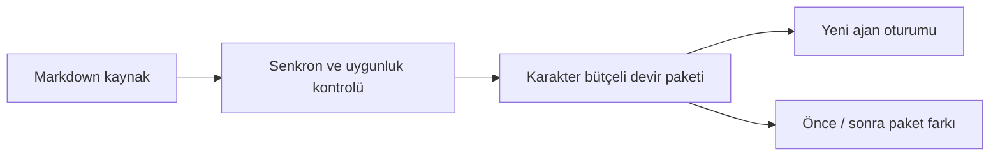

# Ajan değişiminde kararları ve belirsizliği korumak

Bir ajanla alınmış karar başka oturumda öneri sanılabiliyor; eski bir tamamlanma iddiası da doğrulanmış sonuç gibi tekrar edilebiliyor. Mneme'nin yerel Markdown hafızası üzerinde geliştirdiğim kaynaklı devir katmanı bu ayrımları görünür ve sınanabilir hâle getirir.

## Geliştirdiğim katman

`handoff`, açık metadata kullanarak kabul edilmiş kararları, önerileri, açık görevleri ve diğer bağlamı ayırır. Her kayıt kaynak yolu, SHA-256, revision ve alıntı taşır. `handoff-diff` aynı kapsamlı iki paketin kaynak, metadata ve metin değişikliklerini gösterir. Not gövdesindeki “onaylandı” sözcüğü kendiliğinden karar statüsü üretmez.



Tasarım tercihleri:

- Metin kısalabilir; kaynak kimliği ve metadata sessizce kesilmez. Sığmayan kayıt sayısı görünür.
- Özel, reddedilmiş veya güncelliği doğrulanamayan kaynaklar otomatik taşınmaz.
- Paket dışında kalmak, kaynak dosyanın silindiği anlamına gelmez.
- Başka bir ajanın işin bittiğini söylemesi, dış işlemin bağımsız doğrulanması değildir.
- Yeni devir katmanı ek model, sunucu veya üçüncü taraf Python bağımlılığı gerektirmez; gerçek AI istemcisi kullanımı ayrı maliyettir.

## İki dakikalık demo

Python 3.11+ ile `codex/mneme-handoff` geliştirme dalında:

```bash
python scripts/evaluate_v3_handoff.py
python -m unittest discover -s tests -p "v3_handoff_diff_test.py"
```

İlk komut 60 yapay kaynak-paketi senaryosunu çalıştırır; model çağırmaz. İkinci komut kaynak/metadata/metin farkı sözleşmelerini doğrular. Kendi örnek vault'undan paket üretme ve karşılaştırma adımları: [HANDOFF.md](HANDOFF.md). Kişisel notlar yerine yapay kaynaklarla demo yap.

## Gerçek modelle küçük devam deneyi

27 Ekim 2026 tarihinde iki ayrı, salt okunur Codex CLI oturumunda `gpt-6.1-sol` istendi. Birine Mneme paketi, diğerine **aynı altı kaynak kaydının tüm alanlarını koruyan düz liste** verildi. Yedi cevap hedefi çalıştırmalardan önce sabitlendi; kaynak atfı, alıntı içindeki yönlendirmeye uymama ve araç kullanmama ayrıca değerlendirildi.

| Koşul | Başarılı kontrol |
|---|---:|
| Kaynaklı devir paketi | 10/10 |
| Aynı kaynakların düz listesi | 10/10 |

Her iki oturum da PostgreSQL düzeltmesini, öneri/engellenmiş görev ayrımını ve belirsiz teslim durumunu korudu. **Bu deneyde paket lehine cevap kalitesi üstünlüğü gösterilmedi.** Koşul başına tek yapay senaryo, aynı istemciyle devam kontrolüdür; farklı istemciler arası başarı oranı veya genel benchmark değildir. LF'ye normalize edilmiş hazırlık metinleri 4.351 karakterdir. Windows CRLF dosyaları ise 4.484 ve 5.828 bayttır; stdin aktarımında birebir karakter eşitliği doğrulanmadı. Token sayısı, sıralama ve paket sunumu da farklıdır. Bu nedenle tam eşit girdili bir karşılaştırma iddiası kurulmaz.

Girdiler, sabit cevap hedefleri, ham cevaplar ve değerlendirme: [deney kanıtı](../../reports/live-handoff-2026-10-27.json). Hazırlık manifestindeki `model_runs: 0` çalıştırma öncesini; üst düzey `model_runs: 2` tamamlanan deneyi ifade eder. İstemci olayları ayrı bir sunucu model kimliği vermediğinden model adı istenen kimlik olarak kaydedilir.

[60 senaryonun kaynak sözleşmesi](../../reports/handoff-source-contracts-2026-10-26.json) ve [geliştirme PR'ı](https://github.com/haliksuveyt/mneme/pull/1) ayrı kanıtlardır. Kaynak sözleşmesi, gerçek model devamı ve alternatif karşısında üstünlük üç farklı ölçüttür.
